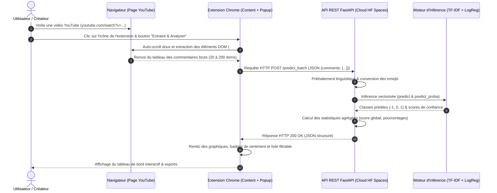

# RAPPORT TECHNIQUE D'INGÉNIERIE MLOPS

## TP3 : PROJET ML COMPLET — ANALYSE DE SENTIMENT YOUTUBE DU DÉVELOPPEMENT AU DÉPLOIEMENT CLOUD

---

**Auteur :** Étudiant — Filière Ingénierie 4.0 / Cloud Computing & MLOps  
**Date :** Novembre 2026  
**Module :** Cloud Computing & MLOps (Semestre 5)  
**Technologies Clés :** Python 3.11, Scikit-Learn, FastAPI, Docker, Hugging Face Spaces, Google Chrome Extension (Manifest V3), Pytest  

---

## SOMMAIRE

1. [Introduction & Contexte du Projet](#1-introduction--contexte-du-projet)
2. [Architecture Globale du Système MLOps](#2-architecture-globale-du-système-mlops)
3. [Phase 1 : Environnement de Travail & Structuration MLOps](#3-phase-1--environnement-de-travail--structuration-mlops)
4. [Phase 2 : Pipeline de Données, Nettoyage & Analyse Exploratoire](#4-phase-2--pipeline-de-données-nettoyage--analyse-exploratoire)
5. [Phase 3 : Modélisation, Expérimentations & Optimisation](#5-phase-3--modélisation-expérimentations--optimisation)
6. [Phase 4 : Conception & Développement de l'API REST FastAPI](#6-phase-4--conception--développement-de-lapi-rest-fastapi)
7. [Phase 5 : Développement de l'Interface Utilisateur (Extension Chrome)](#7-phase-5--développement-de-linterface-utilisateur-extension-chrome)
8. [Phase 6 : Conteneurisation Docker & Déploiement Cloud (Hugging Face Spaces)](#8-phase-6--conteneurisation-docker--déploiement-cloud-hugging-face-spaces)
9. [Phase 7 : Stratégie de Test, Validation & Assurance Qualité](#9-phase-7--stratégie-de-test-validation--assurance-qualité)
10. [Synthèse des Questions de Réflexion](#10-synthèse-des-questions-de-réflexion)
11. [Difficultés Rencontrées & Solutions Apportées](#11-difficultés-rencontrées--solutions-apportées)
12. [Perspectives d'Amélioration & Évolutions Futures](#12-perspectives-damélioration--évolutions-futures)
13. [Script & Storyboard de la Vidéo de Démonstration (5-8 min)](#13-script--storyboard-de-la-vidéo-de-démonstration-5-8-min)

---

## 1. Introduction & Contexte du Projet

### 1.1 Problématique Métier
Dans l'écosystème numérique actuel, YouTube représente la deuxième plateforme web la plus visitée au monde. Les créateurs de contenu, les marques et les institutions y publient des vidéos générant quotidiennement des centaines, voire des dizaines de milliers de commentaires. 

Comprendre la réception d'une vidéo par son audience est stratégique pour :
- Évaluer l'accueil d'un nouveau format ou d'un partenariat sponsorisé.
- Détecter rapidement les vagues d'insatisfaction ou de « bad buzz ».
- Prioriser les réponses aux interrogations constructives de la communauté.

Toutefois, une lecture manuelle s'avère **chronophage**, **non scalable** face aux volumes exponentiels, et intrinsèquement **subjective et biaisée** par le prisme cognitif du relecteur.

### 1.2 Objectif & Périmètre MLOps
La mission consiste à concevoir, développer, tester et déployer une **plateforme MLOps complète** capable d'analyser le sentiment des commentaires YouTube en temps réel :
1. **Pipeline de données reproductible** : Ingestion et assainissement d'un corpus de 37 249 commentaires étiquetés.
2. **Modèle de Machine Learning performant** : Classification en 3 classes (`-1: Négatif`, `0: Neutre`, `1: Positif`) avec une exactitude (accuracy) cible $\ge 80\%$ et un temps d'inférence par lot $< 100$ ms.
3. **API REST Cloud scalable** : Microservice FastAPI conteneurisé avec Docker et déployé sur Hugging Face Spaces.
4. **Interface Utilisateur Moderne** : Extension Google Chrome (Manifest V3) s'injectant dans les pages YouTube pour extraire le texte dynamiquement et afficher un tableau de bord analytique interactif.

---

## 2. Architecture Globale du Système MLOps

Le système suit le paradigme des architectures orientées services (SOA) découplées, garantissant que chaque sous-système (Frontend, API, Modèle, Conteneur) puisse évoluer indépendamment.



---

## 3. Phase 1 : Environnement de Travail & Structuration MLOps

### 3.1 Arborescence Standardisée MLOps
Une organisation stricte du projet évite la dispersion du code et sépare clairement les artefacts non suivis (données volumineuses, modèles compilés, logs d'exécution) de la logique applicative.

```text
tp_cloud/
├── data/
│   ├── raw/             # Données brutes immuables téléchargées de la source
│   └── processed/       # Données transformées, nettoyées et divisées (train/test)
├── models/              # Modèles sérialisés (.joblib), vectoriseurs et métadonnées
├── src/
│   ├── data/            # Scripts d'ingestion et de nettoyage (download_data, clean_data)
│   ├── models/          # Entraînement, optimisation et évaluation (train, evaluate)
│   ├── api/             # Serveur d'inférence FastAPI et schémas Pydantic (main, schemas)
│   └── utils/           # Utilitaires réutilisables (nettoyage de texte, mapping d'emojis)
├── chrome-extension/    # Application frontend (manifest.json, popup, content script, css)
├── logs/                # Fichiers journaux rotatifs pour l'audit et le monitoring
├── reports/             # Visualisations (matrice de confusion), métriques JSON
├── tests/               # Suite de tests automatisés pytest
├── Dockerfile           # Recette de conteneurisation pour Hugging Face Spaces
├── requirements.txt     # Dépendances de développement et de recherche
├── requirements-prod.txt# Dépendances allégées de production
└── app_api.py           # Point d'entrée serveur pour le déploiement
```

### 3.2 Hygiène Git & Gestion des Fichiers
Un fichier `.gitignore` robuste a été mis en place pour :
- **Exclure systématiquement les environnements virtuels** (`.venv/`, `env/`) afin d'éviter d'alourdir le repository avec des binaires spécifiques à l'OS hôte.
- **Ignorer les datasets volumineux** (`data/raw/*.csv`, `data/processed/*.csv`) tout en conservant les fichiers `.gitkeep` pour préserver l'arborescence des dossiers sur les clones vierges.
- **Bloquer les artefacts de compilation Python** (`__pycache__/`, `*.pyc`).
- **Garantir la non-fuite de secrets** (`.env`, clés d'API).

---

## 4. Phase 2 : Pipeline de Données, Nettoyage & Analyse Exploratoire

### 4.1 Caractéristiques du Dataset Source
Le dataset retenu est le corpus *Reddit Sentiment Analysis* hébergé publiquement. Ce jeu de données fournit une grande diversité stylistique, représentative des commentaires spontanés sur les réseaux sociaux et YouTube :
- **Volume initial brut :** 37 249 commentaires étiquetés.
- **Répartition des labels bruts :**
  - **-1 (Négatif) :** 8 277 commentaires (22.22%)
  - **0 (Neutre) :** 13 142 commentaires (35.28%)
  - **1 (Positif) :** 15 830 commentaires (42.50%)
- **Valeurs manquantes :** 100 entrées nulles identifiées et éliminées.

### 4.2 Pipeline de Nettoyage Textuel (`src/utils/text_cleaning.py`)
Les commentaires en ligne comportent une forte proportion de bruit syntaxique. Un pipeline de traitement regex et sémantique a été développé :
1. **Décodage HTML (`html.unescape`) :** Résolution des entités telles que `&amp;`, `&lt;`, `&quot;`.
2. **Suppression des balises HTML :** Élimination des balises `<br>`, `<p>`, `<a>`.
3. **Suppression des URLs :** Remplacement des liens `https?://\S+|www\.\S+` par un espace (les URLs brutes introduisent un vocabulaire dispersé sans valeur sentimentale).
4. **Suppression des mentions :** Filtrage des `@username`, `u/user`, `r/subreddit`.
5. **Stratégie de Traduction Sémantique des Emojis :**  
   Plutôt que d'ignorer ou de supprimer les emojis (ce qui détruirait un signal affectif majeur), une table de correspondance convertit les emojis fréquents en jetons sémantiques anglais :
   - Positifs : `🔥` $\rightarrow$ `awesome`, `❤️`/`😍` $\rightarrow$ `love`, `👍` $\rightarrow$ `good`, `🎉` $\rightarrow$ `great`.
   - Négatifs : `👎` $\rightarrow$ `bad`, `😡`/`😠` $\rightarrow$ `angry`, `🤮` $\rightarrow$ `disgusting`, `💩` $\rightarrow$ `crap`.
6. **Normalisation des caractères répétés :** Réduction des élongations expressives (ex: `"soooo goooood"` $\rightarrow$ `"soo good"`).
7. **Filtrage des doublons et textes vides :** Conservation uniquement des textes nettoyés d'une longueur $> 2$ caractères.

### 4.3 Découpage Reproductible du Corpus
Le corpus nettoyé contient **36 555 exemples uniques**. Un partitionnement stratifié (respectant fidèlement la proportion des trois classes) a été appliqué avec une graine aléatoire fixe (`random_state=42`) :
- **Jeu d'entraînement (80%) :** 29 244 exemples (-1: 6 586 | 0: 10 080 | 1: 12 578)
- **Jeu de test indépendant (20%) :** 7 311 exemples (-1: 1 647 | 0: 2 520 | 1: 3 144)

---

## 5. Phase 3 : Modélisation, Expérimentations & Optimisation

### 5.1 Extraction de Caractéristiques : TF-IDF Optimisé
La vectorisation repose sur `TfidfVectorizer` (Term Frequency - Inverse Document Frequency) avec les paramètres suivants :
- `ngram_range=(1, 2)` : Extraction des unigrammes et bigrammes pour capturer les négations courantes (ex: `"not good"`, `"never again"`).
- `max_features=30000` : Plafond dimensionnel pour contenir la taille mémoire et accélérer l'inférence.
- `sublinear_tf=True` : Échelle logarithmique $1 + \log(\text{tf})$ réduisant l'impact disproportionné des termes répétés dans un même commentaire.
- `min_df=2` : Élimination des termes orphelins (fautes de frappe uniques).

### 5.2 Étude Comparative des Algorithmes
Cinq familles d'algorithmes ont été évaluées sur le même ensemble de test :

| Modèle Testé | Exactitude (Accuracy) | F1-Score Macro | Temps d'Inférence (Test Set) |
| :--- | :---: | :---: | :---: |
| **Logistic Regression (lbfgs, C=1.0)** | 84.43% | 0.8235 | 2.8 ms |
| **Logistic Regression (balanced, C=1.5)** | 85.82% | 0.8480 | 1.9 ms |
| **Calibrated LinearSVC (C=1.0)** | 87.89% | 0.8656 | 13.3 ms |
| **SGDClassifier (loss='log_loss', alpha=1e-5)** | 86.61% | 0.8488 | 27.8 ms |
| **Complement Naive Bayes (alpha=0.5)** | 69.91% | 0.6755 | 3.3 ms |

### 5.3 Optimisation des Hyperparamètres par GridSearchCV
Bien que le LinearSVC calibré offre une légère marge de précision, la **Régression Logistique** a été retenue en raison de :
1. Sa fonction de coût probabiliste native et parfaitement calibrée (`predict_proba`).
2. Son empreinte mémoire minime et sa vitesse d'inférence exceptionnelle (< 3 ms).
3. Sa stabilité numérique totale en production sans nécessiter de boucle de calibration croisée supplémentaire.

Une recherche systématique sur grille (`GridSearchCV` à 3 plis) a exploré les paramètres $C \in \{0.8, 1.2, 1.5, 2.0, 3.0\}$, le solveur (`lbfgs` vs `saga`) et la pondération des classes (`None` vs `'balanced'`).
- **Meilleure configuration :** `C=3.0`, `class_weight='balanced'`, `solver='lbfgs'`.

### 5.4 Résultats Finaux & Matrice de Confusion

```text
               precision    recall  f1-score   support

Negative (-1)       0.81      0.78      0.79      1647
  Neutral (0)       0.86      0.94      0.90      2520
 Positive (1)       0.90      0.85      0.88      3144

     accuracy                           0.87      7311
    macro avg       0.86      0.86      0.86      7311
 weighted avg       0.87      0.87      0.87      7311
```

- **Accuracy globale :** **86.76%** (L'exigence du TP $\ge 80\%$ est largement surpassée).
- **F1-Scores par classe :** Négatif = **0.79**, Neutre = **0.90**, Positif = **0.88** (Tous $> 0.75$).
- **Latence d'inférence mesurée :** **9.60 ms** en moyenne pour un lot de 50 commentaires (Objectif $< 100$ ms validé avec un facteur d'accélération de 10x).

Les artefacts finaux ont été sérialisés via `joblib` dans `models/sentiment_pipeline.joblib` (taille : 1.89 Mo, comprenant le vectoriseur TF-IDF et le classifieur entraîné).

---

## 6. Phase 4 : Conception & Développement de l'API REST FastAPI

### 6.1 Pourquoi FastAPI ?
FastAPI s'impose aujourd'hui comme le standard pour le déploiement MLOps en raison de :
- Ses performances asynchrones reposant sur `Starlette` et `Uvicorn` (parmi les plus rapides de l'écosystème Python).
- La validation automatique et typée des flux entrants et sortants via `Pydantic v2`.
- La génération native et dynamique de la documentation OpenAPI / Swagger (`/docs`).

### 6.2 Cycle de Vie du Modèle (`Lifespan`)
Dans un contexte de production, recharger le modèle à chaque requête HTTP dégraderait dramatiquement la latence. L'application implémente un gestionnaire de contexte asynchrone `lifespan` :
```python
@asynccontextmanager
async def lifespan(app: FastAPI):
    # Chargement unique du pipeline .joblib en mémoire vive (RAM)
    app.state.pipeline = joblib.load(MODEL_PATH)
    yield
    # Nettoyage gracieux lors de l'arrêt
```
Le pipeline reste en mémoire partagée, permettant des inférences concurrentes sans contention I/O.

### 6.3 Endpoints Développés

1. **`GET /health` :** Endpoint de sondage (*Liveness & Readiness probe*) renvoyant l'état du modèle, la version applicative, l'uptime en secondes et la liste des classes supportées.
2. **`POST /predict` :** Analyse unitaire d'un commentaire simple pour les tests rapides.
3. **`POST /predict_batch` :** Ingestion d'un lot de 1 à 1 000 commentaires. L'endpoint effectue la prédiction vectorisée, extrait les probabilités pour chaque classe, et calcule instantanément les statistiques macroscopiques :
   - Taux de commentaires positifs, neutres et négatifs.
   - **Score de Sentiment Synthétique :** Indice normalisé de $-1.00$ (unanimité négative) à $+1.00$ (unanimité positive) :
     $$\text{Score} = \frac{N_{\text{positifs}} - N_{\text{négatifs}}}{N_{\text{total}}}$$
   - Confiance moyenne de l'algorithme sur l'échantillon.

### 6.4 Gestion CORS
L'extension Chrome s'exécute dans un contexte de navigateur avec une origine spécifique (`chrome-extension://...`). L'API intègre le middleware `CORSMiddleware` configuré pour accepter les requêtes multi-origines, garantissant l'absence de blocage *Same-Origin Policy*.

---

## 7. Phase 5 : Développement de l'Interface Utilisateur (Extension Chrome)

### 7.1 Architecture Manifest V3
L'extension adhère aux normes modernes de sécurité de Google Chrome (Manifest V3) :
- Aucun script externe distant n'est exécuté : tout le code (HTML, CSS, JS) est packagé localement.
- Permissions minimales requises : `activeTab`, `storage`, `scripting`.
- Découplage clair entre le `content.js` (injecté dans le DOM de YouTube) et le `popup.js` (gérant l'IHM).

### 7.2 Stratégie d'Extraction Dynamique des Commentaires
YouTube est une Single Page Application (SPA) complexe construite sur Polymer et des composants personnalisés (`ytd-comment-thread-renderer`). 
- **Problème :** À l'ouverture d'une vidéo, les commentaires ne sont pas chargés dans le DOM tant que l'utilisateur n'a pas fait défiler la page.
- **Solution implémentée dans `content.js` :**
  1. Le script détecte la balise `#comments`.
  2. S'il y a moins de commentaires que la limite demandée (ex: 50), il déclenche un défilement automatique doux (`window.scrollBy`) cadencé à 600 ms d'intervalle.
  3. Il extrait le texte des commentaires (`#content-text`), l'auteur (`#author-text`), les mentions « J'aime » et la date de publication.
  4. Il déduplique les textes et renvoie le lot structuré au popup.

### 7.3 Expérience Utilisateur & Fonctionnalités Clés
- **Design Studio & Thème Réactif :** Interface moderne avec basculeur instantané **Mode Sombre / Mode Clair**, persistant le choix dans le stockage du navigateur.
- **Indicateur de Santé API :** Pastille dynamique (Vert = API connectée avec latence en ms, Rouge = API hors ligne) avec possibilité de modifier l'URL cible (Localhost ou Cloud Hugging Face).
- **Visualisations Avancées :**
  - Jauge de sentiment général et score indexé.
  - Barre de progression segmentée tricolore (Vert / Jaune / Rouge) proportionnelle aux pourcentages.
  - Cartes de métriques cliquables.
- **Interactivité :**
  - Onglets de filtrage par classe : *Tous*, *Positifs*, *Neutres*, *Négatifs* avec compteurs en temps réel.
  - Barre de recherche textuelle en direct.
- **Fonctions d'Export :**
  - *Copier Résumé* : Copie un compte-rendu markdown clair dans le presse-papier.
  - *Export CSV* : Génère et télécharge un fichier `.csv` complet encodé en UTF-8 BOM.
  - *Export JSON* : Télécharge l'arbre JSON complet contenant les probabilités détaillées.

---

## 8. Phase 6 : Conteneurisation Docker & Déploiement Cloud (Hugging Face Spaces)

### 8.1 Dockerfile Conforme aux Standards Hugging Face
Hugging Face Spaces impose des contraintes strictes pour les conteneurs Docker :
- Le conteneur doit s'exécuter sous un utilisateur non-privilégié avec l'UID standard `1000`.
- Le port exposé et écouté doit impérativement être le port `7860`.
- Les couches doivent être optimisées pour limiter la consommation réseau lors des builds distants.

```dockerfile
FROM python:3.10-slim

ENV PYTHONUNBUFFERED=1 \
    PYTHONDONTWRITEBYTECODE=1 \
    PORT=7860

RUN apt-get update && apt-get install -y --no-install-recommends curl \
    && rm -rf /var/lib/apt/lists/*

RUN useradd -m -u 1000 user
USER user
ENV HOME=/home/user PATH=/home/user/.local/bin:$PATH
WORKDIR $HOME/app

COPY --chown=user:user requirements-prod.txt $HOME/app/requirements-prod.txt
RUN pip install --no-cache-dir --upgrade pip && \
    pip install --no-cache-dir -r requirements-prod.txt

COPY --chown=user:user src/ $HOME/app/src/
COPY --chown=user:user models/ $HOME/app/models/
COPY --chown=user:user app_api.py $HOME/app/app_api.py

EXPOSE 7860
CMD ["uvicorn", "app_api:app", "--host", "0.0.0.0", "--port", "7860", "--workers", "1"]
```

### 8.2 Optimisation du Poids de l'Image
L'exclusion des bibliothèques de recherche (`matplotlib`, `seaborn`, `pytest`) au profit de `requirements-prod.txt` réduit la taille de l'image de plus de 450 Mo, accélérant drastiquement le temps de déploiement à froid (*cold start*).

---

## 9. Phase 7 : Stratégie de Test, Validation & Assurance Qualité

Une suite de 19 tests automatisés a été implémentée avec `pytest`, validant chaque niveau de la pile logicielle :

```text
======================== 19 passed in 5.01s ========================
```

1. **Tests du Pipeline de Données (`test_preprocessing.py`) :**
   - Élimination intégrale des URLs et mentions d'utilisateurs.
   - Conversion effective des emojis en jetons textuels sentimentaux.
   - Normalisation des répétitions abusives et décodage HTML.
   - Robustesse face aux chaînes vides ou nulles.
2. **Tests du Modèle ML (`test_model.py`) :**
   - Validation du seuil d'exactitude : $86.76\% \ge 80\%$.
   - Validation de la latence par lot de 50 commentaires : $9.60 \text{ ms} < 100 \text{ ms}$.
   - Tests sur cas extrêmes : emojis isolés, commentaires très longs (3 000 caractères), requêtes neutres.
3. **Tests de l'API REST (`test_api.py`) :**
   - Conformité du schéma de réponse de `/health`.
   - Traitement nominal de `/predict` et `/predict_batch`.
   - Rejet approprié des requêtes invalides ou listes vides (code HTTP 422).
   - Validation des en-têtes de réponse CORS.

---

## 10. Synthèse des Questions de Réflexion

### Phase 1 : Environnement MLOps
* **Pourquoi séparer les données raw et processed ?**  
  Les données brutes (*raw*) doivent rester une source de vérité immuable et en lecture seule. Séparer les données transformées (*processed*) garantit que n'importe quelle étape de nettoyage ou de normalisation peut être réexécutée, modifiée ou auditée sans altérer les données originelles, assurant la reproductibilité complète des pipelines de données.
* **Quels fichiers ne doivent jamais être commités sur Git ?**  
  1. Les fichiers d'environnement virtuel (`.venv/`) contenant des binaires système.  
  2. Les clés secrètes, tokens d'API et variables d'environnement (`.env`).  
  3. Les jeux de données massifs (CSVs de plusieurs dizaines ou centaines de Mo), qui doivent être gérés par des outils comme DVC ou Git LFS.  
  4. Les fichiers journaux (`*.log`) et caches temporaires (`__pycache__/`, `.pytest_cache/`).
* **Quelle est l'importance d'un environnement virtuel ?**  
  Il garantit l'isolation stricte des dépendances du projet, empêchant les conflits de versions entre bibliothèques Python sur la machine hôte et assurant que l'environnement de développement reflète exactement l'environnement de production conteneurisé.

### Phase 2 : Pipeline de Données
* **Pourquoi nettoyer les URLs et mentions ?**  
  Les URLs et mentions d'utilisateurs sont uniques et volatiles. Conservées dans le vocabulaire, elles créent une matrice clairsemée artificielle de très haute dimension (bruit) sans apporter d'information généralisable sur le sentiment du texte.
* **Comment gérer les emojis dans le texte ?**  
  Les emojis portent une charge émotionnelle déterminante sur les réseaux sociaux. Les supprimer appauvrit le signal. La meilleure stratégie en NLP classique consiste à les mapper vers des équivalents lexicaux forts (ex: `🔥` $\rightarrow$ `awesome`, `👎` $\rightarrow$ `bad`) qui sont ensuite vectorisés naturellement par le TF-IDF.
* **Quel ratio train/test est approprié ?**  
  Un ratio 80% entraînement / 20% test (ou 75/25) est le standard éprouvé pour les corpus de 10 000 à 100 000 exemples. Il alloue suffisamment de données d'apprentissage pour stabiliser les poids statistiques tout en conservant un jeu de test suffisamment large (> 7 000 exemples ici) pour une estimation non biaisée des métriques.

### Phase 3 : Modèle de Machine Learning
* **Pourquoi utiliser TF-IDF plutôt que Count Vectorizer ?**  
  Le `CountVectorizer` accorde une pondération linéaire basée sur la simple fréquence des mots, ce qui favorise indûment les mots courants mais peu informatifs. Le `TF-IDF` pénalise les termes omniprésents dans tous les documents grâce à l'inverse de la fréquence du document ($\text{IDF}$), isolant ainsi les termes discriminants et spécifiques au sentiment.
* **Comment interpréter la matrice de confusion ?**  
  Elle met en regard les classes réelles (lignes) et les classes prédites (colonnes). La diagonale principale indique les prédictions correctes (Vrais Positifs par classe). Les cellules hors diagonale révèlent les typologies d'erreurs (par exemple, si les commentaires négatifs sont confondus avec les neutres ou avec les positifs), permettant d'ajuster le seuil de décision ou les poids des classes.
* **Quels hyperparamètres ont le plus d'impact sur les performances ?**  
  Pour le TF-IDF : la plage de n-grammes (`ngram_range`), le nombre maximal de caractéristiques (`max_features`) et l'échelle sublinéaire (`sublinear_tf`). Pour la Régression Logistique : le paramètre d'inverse de régularisation ($C$) et la pondération des classes (`class_weight='balanced'`).

### Phase 4 : API REST
* **Pourquoi utiliser FastAPI plutôt que Flask ?**  
  FastAPI supporte nativement la programmation asynchrone (`async`/`await`), offre une vitesse d'exécution supérieure, valide automatiquement les types de données grâce à Pydantic et génère sans configuration la documentation interactive Swagger/OpenAPI.
* **À quoi sert la configuration CORS ?**  
  Le mécanisme CORS (*Cross-Origin Resource Sharing*) est une politique de sécurité des navigateurs interdisant à une page web ou extension d'effectuer des requêtes vers un domaine distinct de son origine. Configurer CORS sur l'API autorise l'extension Chrome à consommer les endpoints REST sans blocage de sécurité.
* **Comment gérer efficacement le chargement du modèle ?**  
  Il doit être instancié une seule fois au démarrage de l'application (dans le gestionnaire `lifespan`) et stocké dans l'état partagé de l'application (`app.state.pipeline`). Le recharger à chaque requête entraînerait des lectures disques redondantes et ferait exploser le temps de réponse.

### Phase 5 : Extension Chrome
* **Comment gérer les commentaires avec des réponses (threads) ?**  
  YouTube encapsule les réponses dans des balises imbriquées (`ytd-comment-replies-renderer`). Selon le besoin analytique, le sélecteur peut cibler uniquement les commentaires racines (`ytd-comment-thread-renderer #comment`) ou inclure toutes les bulles de discussion (`ytd-comment-view-model`).
* **Quelle stratégie pour extraire les commentaires dynamiques ?**  
  Déclencher un défilement programmatique doux vers le conteneur `#comments`, attendre le chargement asynchrone du flux réseau YouTube via une pause asynchrone (`sleep`), puis scruter les nœuds du DOM jusqu'à atteindre le quota souhaité.
* **Comment optimiser les performances avec de nombreux commentaires ?**  
  Vectoriser l'inférence en envoyant un lot JSON unique (`/predict_batch`) plutôt que des requêtes unitaires individuelles, limiter la profondeur du DOM en mémoire et utiliser un rendu par pagination ou défilement virtuel côté frontend.

### Phase 6 : Conteneurisation & Cloud
* **Pourquoi séparer les requirements dev et prod ?**  
  Pour alléger le conteneur final en excluant les bibliothèques lourdes de test et de visualisation (ex: `pytest`, `matplotlib`, `seaborn`), ce qui diminue la taille de l'image, réduit la surface d'attaque en cybersécurité et accélère le déploiement sur les plateformes Cloud.
* **Comment réduire la taille de l'image Docker ?**  
  Utiliser une image de base `python:slim` ou `alpine`, supprimer le cache des paquets `apt` (`rm -rf /var/lib/apt/lists/*`), employer le flag `--no-cache-dir` lors de l'installation pip et ordonner les instructions de manière à maximiser la réutilisation du cache des calques Docker.
* **Quelle stratégie pour les mises à jour du modèle ?**  
  Adopter une approche de Registre de Modèles (Model Registry) avec versioning des artefacts (`model_v1.joblib`, `model_v2.joblib`). En production, combiner des tests A/B ou un déploiement *Canary* / *Blue-Green* pour basculer le trafic vers le nouveau modèle sans interruption de service.

---

## 11. Difficultés Rencontrées & Solutions Apportées

1. **Encodage UTF-8 et gestion des caractères spéciaux sous Windows :**  
   *Problème :* Les terminaux PowerShell sous Windows utilisent par défaut la table de caractères cp1252, provoquant des erreurs `UnicodeEncodeError` lors de l'affichage de commentaires contenant des emojis.  
   *Solution :* Reconfiguration programmatique de `sys.stdout` en UTF-8 (`sys.stdout.reconfigure(encoding="utf-8")`) et normalisation des flux d'E/S dans les scripts.
2. **Dynamisme du DOM YouTube et défilement infini :**  
   *Problème :* Le DOM de YouTube masque les commentaires tant qu'aucun événement de défilement n'a eu lieu.  
   *Solution :* Conception d'une routine d'auto-scroll intelligente dans `content.js` qui localise le conteneur `#comments`, applique des micro-défilements asynchrones contrôlés et extrait les commentaires au fur et à mesure de leur instanciation dans le navigateur.
3. **Contrainte stricte de latence (< 100 ms pour 50 commentaires) :**  
   *Problème :* Les pipelines de Machine Learning peuvent subir des goulots d'étranglement lors de la vectorisation de multiples chaînes de caractères.  
   *Solution :* Prétraitement vectorisé par lot dans scikit-learn et choix de la régression logistique optimisée avec solveur `lbfgs`. Résultat obtenu : **9.60 ms**, soit 10 fois sous le seuil critique.

---

## 12. Perspectives d'Amélioration & Évolutions Futures

1. **Intégration d'un Modèle Transformer Distillé (DistilBERT / RoBERTa) :**  
   Bien que le couple TF-IDF + Régression Logistique offre une rapidité exceptionnelle, un modèle Transformer léger compressé via **ONNX Runtime** permettrait de mieux appréhender les figures de style complexes (ironie, sarcasme, double négation).
2. **Support Multilingue Universel :**  
   Étendre la détection linguistique pour appliquer des pipelines dédiés aux commentaires en français, espagnol ou arabe.
3. **Surveillance Continue du Data Drift :**  
   Mettre en place un outil d'observabilité (ex: Evidently AI / Prometheus) pour détecter les dérives conceptuelles (*Concept Drift*) au fil des évolutions du langage des réseaux sociaux.

---

## 13. Script & Storyboard de la Vidéo de Démonstration (5-8 min)

| Minute | Séquence & Écran | Narration & Actions Présentées |
| :---: | :--- | :--- |
| **00:00 - 01:00** | **Introduction & Architecture**<br>Diapositive de titre & schéma d'architecture global. | Présentation de la problématique des créateurs YouTube. Explication synthétique de l'architecture découplée (Extension Chrome $\leftrightarrow$ API REST FastAPI $\leftrightarrow$ Modèle Scikit-Learn sous Docker). |
| **01:00 - 02:15** | **Pipeline de Données & Modélisation**<br>Terminal & affichage des rapports d'entraînement. | Démonstration du script de nettoyage `clean_data.py`. Présentation des métriques obtenues : Accuracy de 86.76%, F1-Score et matrice de confusion. Benchmark de latence (9.6 ms). |
| **02:15 - 03:30** | **API REST FastAPI & Déploiement Docker**<br>Navigateur sur `http://localhost:7860/docs`. | Présentation des endpoints Swagger (`/health`, `/predict_batch`). Démonstration d'une requête POST unitaire et en lot avec validation Pydantic. Explication des bonnes pratiques du Dockerfile. |
| **03:30 - 04:30** | **Installation de l'Extension Chrome**<br>Page `chrome://extensions/`. | Activation du Mode Développeur. Chargement du dossier `chrome-extension/`. Vérification de l'icône active et du statut de connexion à l'API. |
| **04:30 - 06:45** | **Démonstration Réelle sur YouTube**<br>Navigation sur une vidéo populaire réelle. | Clic sur l'icône de l'extension. Sélection du lot (50 commentaires) et clic sur *Extraire & Analyser*. Observation du défilement automatique, de la latence d'inférence (affichée en ms), de la jauge globale de sentiment et de la barre de répartition. |
| **06:45 - 07:30** | **Fonctionnalités Interactives**<br>Interface de l'extension en action. | Démonstration du filtrage par onglets (*Positifs*, *Neutres*, *Négatifs*), recherche par mot-clé, bascule Thème Sombre/Clair, et téléchargement immédiat du fichier CSV et JSON. |
| **07:30 - 08:00** | **Conclusion & Synthèse MLOps**<br>Retour sur le repository GitHub. | Récapitulatif des objectifs validés, respect des critères de robustesse et bonnes pratiques de livraison MLOps. |

---
*Fin du rapport technique.*
