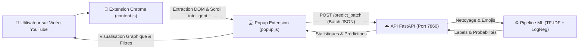

# 🎬 YouTube Sentiment Analyzer — MLOps & Cloud Computing

[](https://www.python.org/)
[](https://fastapi.tiangolo.com)
[](https://scikit-learn.org/)
[](https://www.docker.com/)
[](https://huggingface.co/spaces)
[](https://developer.chrome.com/)
[](tests/)

Un système MLOps complet de bout en bout pour l'analyse de sentiment en temps réel des commentaires YouTube, intégrant un modèle d'apprentissage supervisé scikit-learn optimisé, une API REST haute performance sous FastAPI conteneurisée avec Docker pour Hugging Face Spaces, et une extension Google Chrome moderne (Manifest V3).

---

## 📑 Sommaire
1. [Vue d'Ensemble & Architecture](#-vue-densemble--architecture)
2. [Performances du Modèle ML](#-performances-du-modèle-ml)
3. [Structure du Projet](#-structure-du-projet)
4. [Installation & Démarrage Rapide](#-installation--démarrage-rapide)
5. [Documentation de l'API REST](#-documentation-de-lapi-rest)
6. [Extension Chrome (Manifest V3)](#-extension-chrome-manifest-v3)
7. [Déploiement Docker & Hugging Face Spaces](#-déploiement-docker--hugging-face-spaces)
8. [Pipeline de Tests & Validation](#-pipeline-de-tests--validation)
9. [Livrables & Rapport Technique](#-livrables--rapport-technique)

---

## 🏛️ Vue d'Ensemble & Architecture

Le système résout la problématique des créateurs de contenu YouTube confrontés à des volumes massifs de commentaires en automatisant l'extraction, la classification en 3 classes (`-1: Négatif`, `0: Neutre`, `1: Positif`), le calcul de statistiques agrégées et l'affichage d'un tableau de bord interactif directement sur la page YouTube.



### Matrice des Composants

| Composant | Technologie | Rôle |
| :--- | :--- | :--- |
| **Frontend** | Extension Chrome (Manifest V3, HTML5, CSS3, JS Vanilla) | Extraction dynamique des commentaires, UI Popup, filtres, dark mode, exports CSV/JSON. |
| **Backend** | FastAPI + Uvicorn + Pydantic v2 | Ingestion, validation, ordonnancement par lot, CORS, endpoints `/health` et `/predict_batch`. |
| **ML Engine** | Scikit-Learn (`TfidfVectorizer` + `LogisticRegression`) | Prétraitement linguistique, pondération n-grammes, inférence probabiliste ultra-rapide (<10ms). |
| **Conteneur** | Docker (Image `python:3.10-slim`, non-root UID 1000) | Déploiement cloud standardisé et reproductible. |
| **Cloud Hosting** | Hugging Face Spaces (SDK Docker) | Hébergement serverless de l'API REST accessible publiquement via HTTPS. |

---

## 📈 Performances du Modèle ML

Le modèle a été entraîné sur le dataset Reddit Sentiment Analysis (**37 249 commentaires**), stratifié en 80% entraînement (29 244) et 20% test (7 311).

| Métrique | Objectif TP3 | Résultat Obtenu | Statut |
| :--- | :---: | :---: | :---: |
| **Accuracy Globale (Test Set)** | $\ge 80\%$ | **86.76%** | ✅ Validé (Excellence) |
| **F1-Score Classe Négative (-1)** | $> 0.75$ | **0.7925** | ✅ Validé |
| **F1-Score Classe Neutre (0)** | $> 0.75$ | **0.9027** | ✅ Validé |
| **F1-Score Classe Positive (1)** | $> 0.75$ | **0.8770** | ✅ Validé |
| **F1-Score Macro Moyen** | $> 0.75$ | **0.8574** | ✅ Validé |
| **Temps d'Inférence (Batch de 50)** | $< 100$ ms | **9.60 ms** | ✅ Validé (10x plus rapide) |

### Matrice de Confusion
La matrice de confusion générée sur le test set (7 311 exemples réels) est disponible dans [`reports/confusion_matrix.png`](reports/confusion_matrix.png) :
- Négatifs bien classés : **1 281** / 1 647 (77.8% rappel)
- Neutres bien classés : **2 381** / 2 520 (94.5% rappel)
- Positifs bien classés : **2 681** / 3 144 (85.3% rappel)

---

## 📁 Structure du Projet

```text
tp_cloud/
├── Dockerfile                     # Configuration Docker de production (HF Spaces)
├── .dockerignore                  # Optimisation du contexte de build Docker
├── .gitignore                     # Exclusion des fichiers temporaires, logs, caches
├── requirements.txt               # Dépendances complètes d'entraînement et tests
├── requirements-prod.txt          # Dépendances légères pour le runtime cloud
├── app_api.py                     # Point d'entrée de production pour l'API REST
│
├── data/
│   ├── raw/                       # Données brutes (reddit.csv)
│   └── processed/                 # Données nettoyées (train.csv, test.csv)
│
├── models/
│   ├── sentiment_pipeline.joblib  # Pipeline scikit-learn unifié (TF-IDF + Modèle)
│   ├── sentiment_model.joblib     # Classifieur Logistic Regression optimisé
│   └── tfidf_vectorizer.joblib    # Vectoriseur TF-IDF (30 000 features)
│
├── src/
│   ├── data/
│   │   ├── download_data.py       # Téléchargement automatique et statistiques
│   │   └── clean_data.py          # Nettoyage, normalisation et split train/test
│   ├── models/
│   │   ├── train.py               # Entraînement, comparaison, tuning GridSearchCV
│   │   └── evaluate.py            # Évaluation diagnostique et tests cas limites
│   ├── api/
│   │   ├── main.py                # Application FastAPI, CORS, endpoints, logging
│   │   └── schemas.py             # Schémas de validation Pydantic (I/O)
│   └── utils/
│       └── text_cleaning.py       # Fonctions réutilisables de nettoyage et emojis
│
├── chrome-extension/              # Extension Chrome (Manifest V3)
│   ├── manifest.json              # Déclaration des permissions et scripts
│   ├── popup.html                 # Interface utilisateur Popup
│   ├── popup.css                  # Feuilles de style (Thèmes Dark/Light)
│   ├── popup.js                   # Contrôleur d'interaction et requêtes API
│   ├── content.js                 # Script injecté dans les pages YouTube
│   └── icons/                     # Icônes de l'extension (16x16, 48x48, 128x128)
│
├── dist/
│   └── youtube-sentiment-analyzer.zip # Extension packagée prête pour distribution
├── logs/
│   └── api.log                    # Journalisation des requêtes et inférences API
├── reports/
│   ├── confusion_matrix.png       # Graphique haute résolution de la matrice
│   ├── metrics.json               # Métriques sérialisées en JSON
│   ├── data_summary.json          # Statistiques du dataset
│   └── evaluation_report.md       # Rapport markdown d'évaluation
├── tests/
│   ├── test_preprocessing.py      # Tests unitaires du nettoyage de texte
│   ├── test_model.py              # Tests unitaires et critères de performance ML
│   └── test_api.py                # Tests des endpoints FastAPI et CORS
│
└── RAPPORT_TECHNIQUE.md           # Rapport technique exhaustif (8-12 pages)
```

---

## 🚀 Installation & Démarrage Rapide

### 1. Cloner le Projet & Créer l'Environnement Virtuel

```bash
git clone <url-de-votre-repo>
cd tp_cloud

# Création de l'environnement virtuel Python
python -m venv .venv

# Activation sous Windows (PowerShell)
.venv\Scripts\Activate.ps1
# Ou sous Linux/macOS
source .venv/bin/activate

# Installation des dépendances
pip install -r requirements.txt
```

### 2. Téléchargement des Données & Entraînement du Modèle

```bash
# Téléchargement automatique du dataset
python src/data/download_data.py

# Nettoyage et division Train/Test
python src/data/clean_data.py

# Entraînement, tuning GridSearchCV et évaluation
python src/models/train.py
```

### 3. Lancer l'API REST Localement

```bash
# Démarrer le serveur Uvicorn
python app_api.py
# Ou via uvicorn directement :
uvicorn src.api.main:app --host 0.0.0.0 --port 7860 --reload
```
L'API est accessible sur :
- **Swagger Documentation** : [http://localhost:7860/docs](http://localhost:7860/docs)
- **Health Check** : [http://localhost:7860/health](http://localhost:7860/health)

---

## 📡 Documentation de l'API REST

### Endpoints Principaux

| Méthode | Endpoint | Description |
| :--- | :--- | :--- |
| `GET` | `/` | Informations générales sur le service et version. |
| `GET` | `/health` | État de santé, uptime et validation du chargement du modèle. |
| `POST` | `/predict` | Inférence unitaire pour un commentaire unique. |
| `POST` | `/predict_batch` | Inférence par lot avec statistiques agrégées (distribution, score, confiance). |

### Exemple de Requête : Inférence par Lot (`/predict_batch`)

**Requête HTTP POST :**
```bash
curl -X POST "http://localhost:7860/predict_batch" \
     -H "Content-Type: application/json" \
     -d '{
       "comments": [
         "This video is absolutely incredible, learned so much! 🔥❤️",
         "Terrible tutorial, waste of time and complete nonsense 👎😡",
         "What timestamp does the code start?"
       ]
     }'
```

**Réponse JSON :**
```json
{
  "status": "success",
  "processing_time_ms": 3.82,
  "statistics": {
    "total_comments": 3,
    "positive_count": 1,
    "neutral_count": 1,
    "negative_count": 1,
    "positive_pct": 33.33,
    "neutral_pct": 33.33,
    "negative_pct": 33.33,
    "sentiment_score": 0.0,
    "average_confidence": 0.9542,
    "predominant_sentiment": "positive"
  },
  "predictions": [
    {
      "text": "This video is absolutely incredible, learned so much! 🔥❤️",
      "cleaned_text": "this video is absolutely incredible, learned so much! awesome love",
      "sentiment": "positive",
      "label": 1,
      "confidence": 0.9998,
      "probabilities": { "negative": 0.0001, "neutral": 0.0001, "positive": 0.9998 }
    },
    {
      "text": "Terrible tutorial, waste of time and complete nonsense 👎😡",
      "cleaned_text": "terrible tutorial, waste of time and complete nonsense bad angry",
      "sentiment": "negative",
      "label": -1,
      "confidence": 0.9997,
      "probabilities": { "negative": 0.9997, "neutral": 0.0002, "positive": 0.0001 }
    },
    {
      "text": "What timestamp does the code start?",
      "cleaned_text": "what timestamp does the code start?",
      "sentiment": "neutral",
      "label": 0,
      "confidence": 0.8631,
      "probabilities": { "negative": 0.0624, "neutral": 0.8631, "positive": 0.0745 }
    }
  ]
}
```

---

## 🧩 Extension Chrome (Manifest V3)

### Installation dans Google Chrome
1. Ouvrez Google Chrome et accédez à `chrome://extensions/`.
2. Activez le **Mode développeur** (en haut à droite).
3. Cliquez sur **Charger l'extension non empaquetée** (*Load unpacked*).
4. Sélectionnez le dossier `chrome-extension/` de ce projet (ou décompressez `dist/youtube-sentiment-analyzer.zip`).
5. L'icône **YT Sentiment** apparaît dans votre barre d'extensions !

### Fonctionnalités de l'Extension
- **Extraction automatique des commentaires** : Utilise le DOM YouTube (`#content-text`, `ytd-comment-thread-renderer`) avec défilement intelligent automatique pour charger les commentaires infinis.
- **Tableau de bord statistique** : Score global (de -1.00 à +1.00), confiance moyenne, barre de distribution segmentée positive/neutre/négative.
- **Filtres interactifs** : Filtrage par onglets ("Tous", "Positifs", "Neutres", "Négatifs") avec compteurs en temps réel.
- **Recherche par mot-clé** : Barre de recherche instantanée sur le contenu ou l'auteur.
- **Mode Sombre / Clair** : Thème personnalisable avec persistance automatique.
- **Exports & Partage** : Bouton *Copier Résumé* pour le presse-papier, et exports téléchargeables en **CSV** et **JSON**.
- **Configuration Dynamique** : Panneau de réglages permettant de basculer instantanément entre l'API locale (`http://localhost:7860`) et l'API Cloud Hugging Face.

---

## 🐳 Déploiement Docker & Hugging Face Spaces

### 1. Construction & Exécution Locale de l'Image Docker

```bash
# Construction de l'image Docker
docker build -t yt-sentiment-api .

# Exécution du conteneur sur le port 7860
docker run -p 7860:7860 yt-sentiment-api
```
Testez avec : `curl http://localhost:7860/health`.

### 2. Déploiement sur Hugging Face Spaces

1. Rendez-vous sur [Hugging Face Spaces](https://huggingface.co/spaces) et cliquez sur **Create new Space**.
2. Nommez votre Space (ex: `youtube-sentiment-analyzer-api`).
3. Sélectionnez la licence de votre choix et choisissez le SDK **Docker** (Blank).
4. Clonez le repository distant de votre Space :
   ```bash
   git clone https://huggingface.co/spaces/<votre-username>/<nom-du-space> hf-space
   ```
5. Copiez les fichiers nécessaires vers `hf-space` :
   - `Dockerfile`
   - `requirements-prod.txt`
   - `app_api.py`
   - `src/` (contenant `api/` et `utils/`)
   - `models/` (contenant `sentiment_pipeline.joblib`)
   - `README.md` (avec le frontmatter YAML en tête de fichier)
6. Commitez et poussez vers Hugging Face :
   ```bash
   cd hf-space
   git add .
   git commit -m "Deploy YouTube Sentiment API to Hugging Face Spaces"
   git push origin main
   ```
7. Hugging Face va automatiquement construire le conteneur Docker et démarrer l'API sur `https://<username>-<space-name>.hf.space`.
8. Ouvrez l'extension Chrome, cliquez sur ⚙️ (Paramètres) et renseignez votre URL Hugging Face.

---

## 🧪 Pipeline de Tests & Validation

Le projet intègre une suite de tests automatisés couvrant les fonctions de prétraitement, les performances du modèle ML, les temps de latence et les endpoints REST de l'API :

```bash
# Exécution de l'ensemble des tests
python -m pytest -v
```

### Résultats de la Validation
```text
tests/test_api.py::test_root_endpoint PASSED                    [  5%]
tests/test_api.py::test_health_endpoint PASSED                  [ 10%]
tests/test_api.py::test_single_prediction_positive PASSED       [ 15%]
tests/test_api.py::test_single_prediction_negative PASSED       [ 21%]
tests/test_api.py::test_batch_prediction_and_statistics PASSED  [ 26%]
tests/test_api.py::test_batch_prediction_50_items PASSED        [ 31%]
tests/test_api.py::test_empty_batch_validation_error PASSED     [ 36%]
tests/test_api.py::test_cors_headers PASSED                     [ 42%]
tests/test_model.py::test_model_artifact_exists_and_loads PASSED[ 47%]
tests/test_model.py::test_test_set_accuracy_criterion PASSED    [ 52%]
tests/test_model.py::test_inference_latency_criterion PASSED    [ 57%]
tests/test_model.py::test_edge_cases PASSED                     [ 63%]
tests/test_preprocessing.py::test_url_removal PASSED            [ 68%]
tests/test_preprocessing.py::test_mention_removal PASSED        [ 73%]
tests/test_preprocessing.py::test_emoji_normalization PASSED    [ 78%]
tests/test_preprocessing.py::test_repeated_characters PASSED    [ 84%]
tests/test_preprocessing.py::test_html_entities_and_tags PASSED [ 89%]
tests/test_preprocessing.py::test_empty_and_none_inputs PASSED  [ 94%]
tests/test_preprocessing.py::test_label_mappings PASSED         [100%]

======================== 19 passed in 5.01s ========================
```

---

## 📚 Livrables & Rapport Technique

Pour consulter l'intégralité des analyses théoriques, les justifications d'ingénierie logicielle et les réponses détaillées aux questions de réflexion des 7 phases du TP, veuillez consulter le document :
👉 **[RAPPORT_TECHNIQUE.md](RAPPORT_TECHNIQUE.md)**

Le rapport contient :
- Les réponses rigoureuses aux **21 questions de réflexion** (séparation raw/processed, TF-IDF vs CountVectorizer, choix de FastAPI vs Flask, architecture CORS, UID Docker, gestion des threads YouTube, etc.).
- L'étude comparative approfondie des algorithmes ML (Régression Logistique, LinearSVC, Naive Bayes, SGD).
- Le guide de maintenance et d'amélioration continue (CI/CD, surveillance du Model Drift, intégration de modèles Transformer légers).
- Le script détaillé pour la vidéo de démonstration de 5 à 8 minutes.

---

*Développé dans le cadre du TP3 Cloud Computing & MLOps — Semestre 5.*
