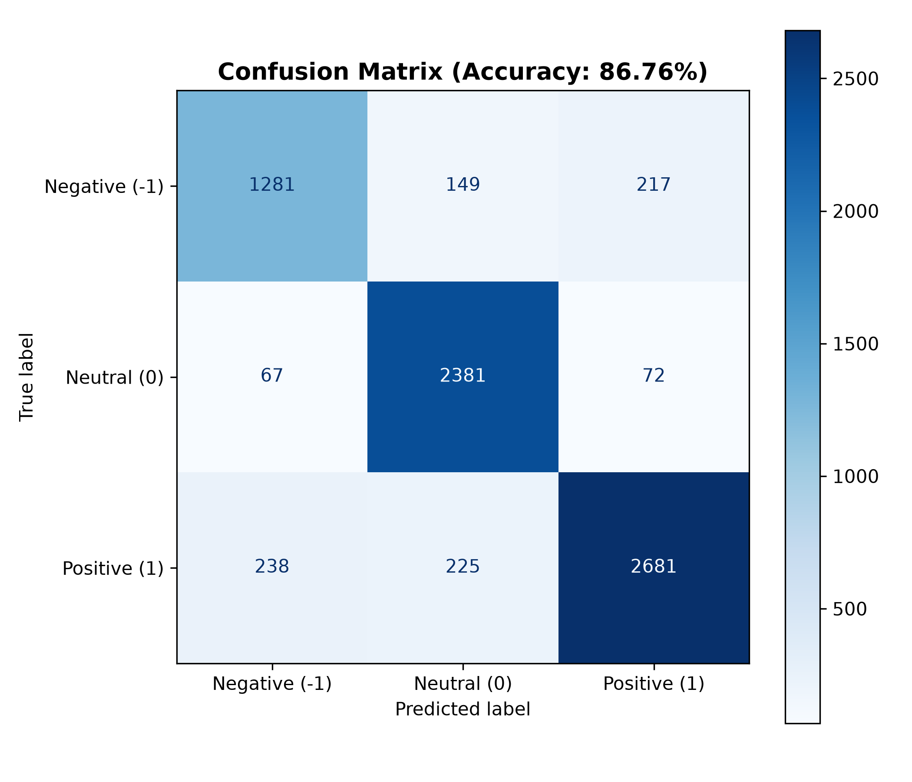

# Rapport d'Évaluation du Modèle de Sentiment

## Métriques Globales
- **Accuracy Test** : 86.76% (Objectif TP : >= 80% -> Validé [OK])
- **F1-Score Macro** : 0.8574
- **F1-Score Négatif (-1)** : 0.7925
- **F1-Score Neutre (0)** : 0.9027
- **F1-Score Positif (1)** : 0.8770
- **Latence d'inférence (batch 50)** : 9.60 ms (Objectif TP : < 100ms -> Validé [OK])

## Meilleurs Hyperparamètres
```json
{
  "C": 3.0,
  "class_weight": "balanced",
  "solver": "lbfgs"
}
```

## Rapport de Classification Détaillé
```
               precision    recall  f1-score   support

Negative (-1)       0.81      0.78      0.79      1647
  Neutral (0)       0.86      0.94      0.90      2520
 Positive (1)       0.90      0.85      0.88      3144

     accuracy                           0.87      7311
    macro avg       0.86      0.86      0.86      7311
 weighted avg       0.87      0.87      0.87      7311

```

## Matrice de Confusion

